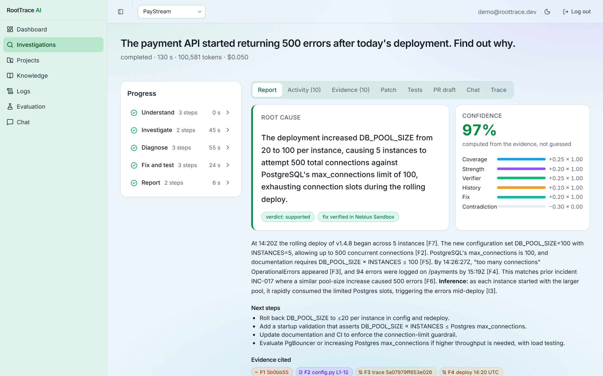
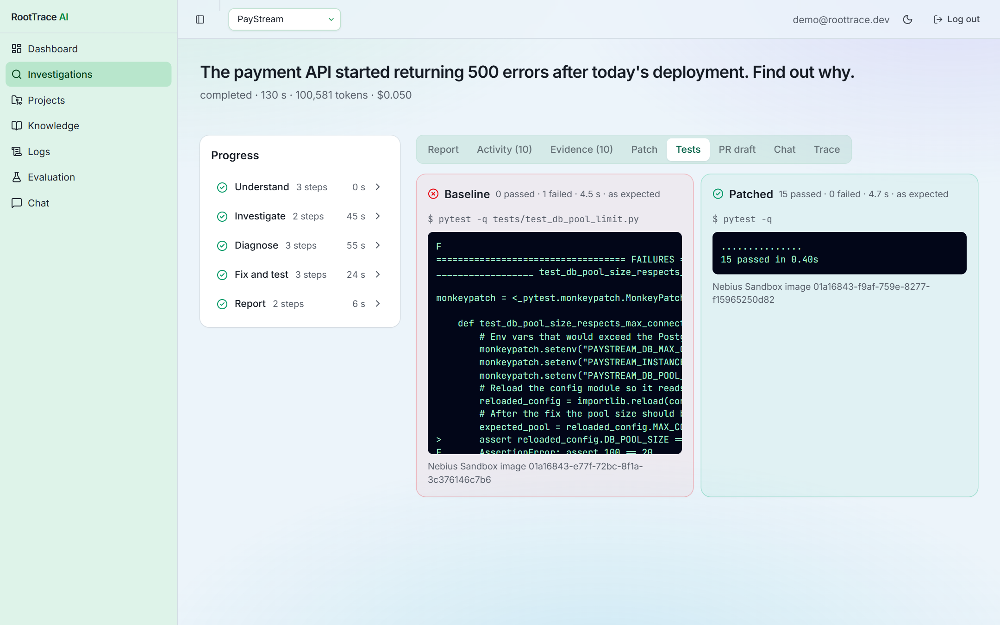
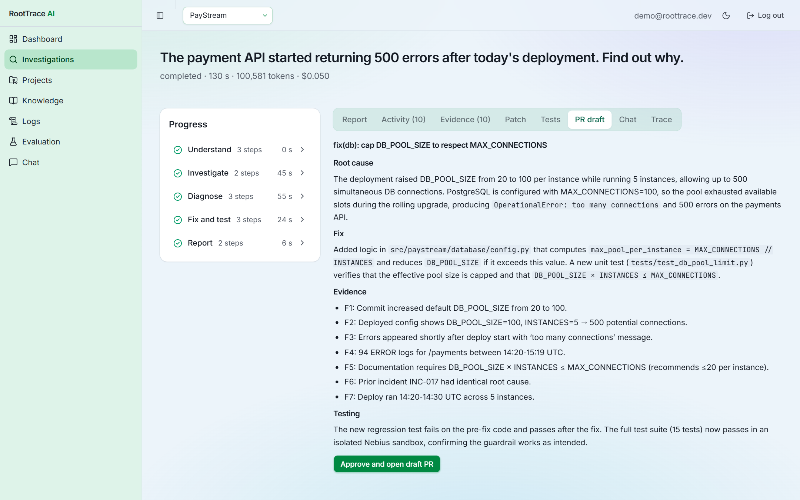
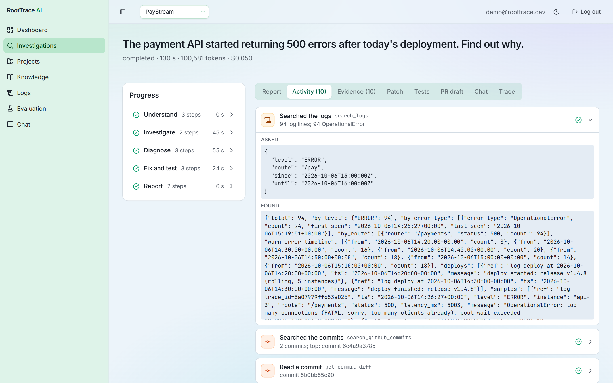
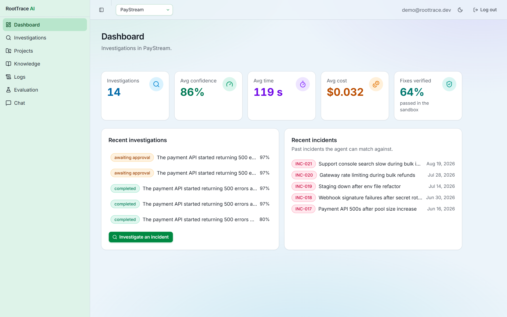
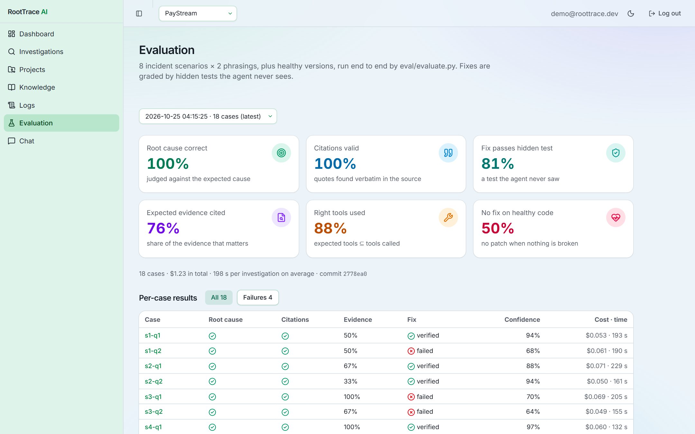
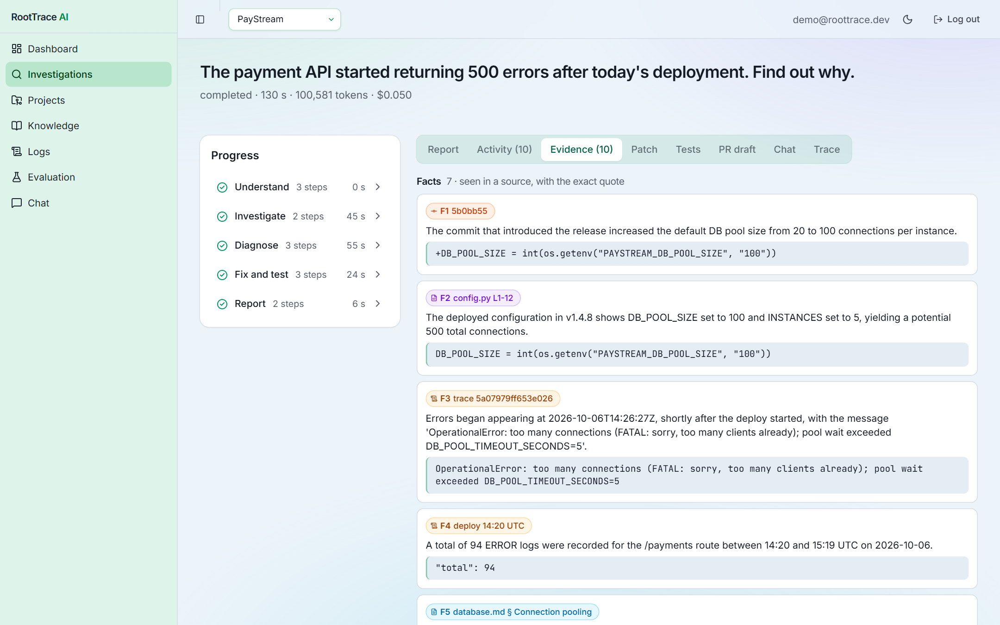
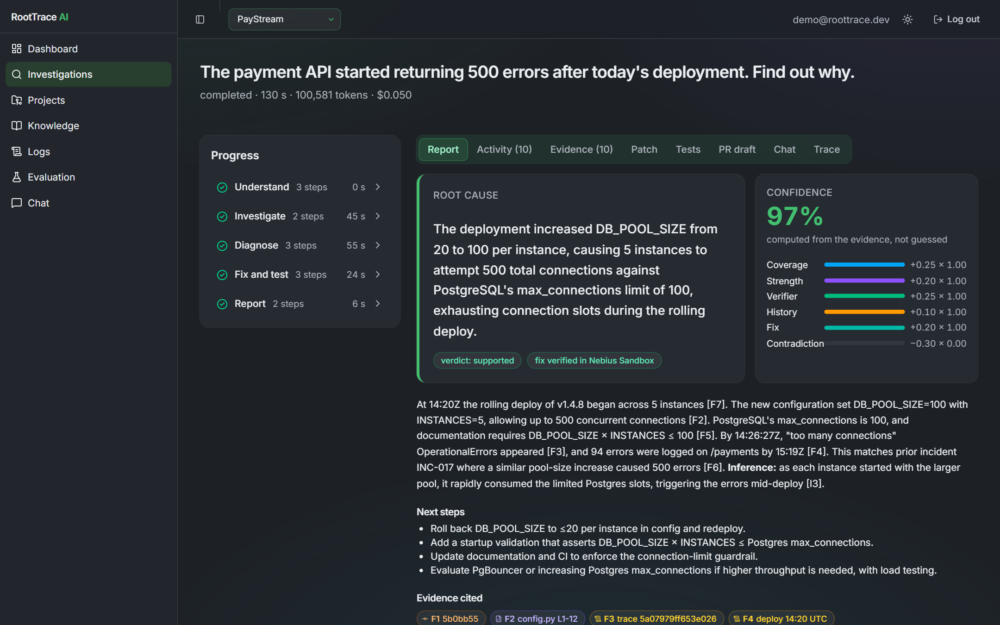

# RootTrace AI — AI Engineering Incident Investigator

> An agent that investigates production incidents across code, commits, docs, logs, GitHub issues and past incidents. It produces an evidence-backed root cause with a confidence score, then **writes, tests and verifies a fix** in a Nebius Sandbox and drafts the pull request.

**Built for the Nebius × NVIDIA Global AI Hackathon** · Primary track: *Coding & Agentic Engineering* · Secondary: *Best Apps & Agents*

- All LLM calls run on **Nebius Token Factory** using **NVIDIA Nemotron 3** models (Ultra / Super / Nano).
- Patches are tested in **Nebius Token Factory Sandboxes**.

<p>
  <a href="#run-it-yourself"><b>Run it</b></a> ·
  <a href="#screenshots"><b>Screenshots</b></a> ·
  <a href="#evaluation"><b>Evaluation</b></a> ·
  <a href="docs/FEEDBACK.md"><b>Feedback on Nebius &amp; NVIDIA</b></a> ·
  <a href="docs/IMPLEMENTATION_PLAN.md">Implementation plan</a>
</p>

| | |
|---|---|
| **Live demo** | [https://roottrace-tau.vercel.app](https://roottrace-tau.vercel.app) (click **Try the demo**, no account needed) |
| **Demo video** | [https://youtu.be/MXaXElD_aA4](https://youtu.be/MXaXElD_aA4) |
| **Source code** | [https://github.com/apsariUdithara/roottrace-incident-agent-ROOTTRACE-AI](https://github.com/apsariUdithara/roottrace-incident-agent-ROOTTRACE-AI) |

> The demo runs on free hosting (Vercel + Render + Neon). If the backend has been idle, the first page load can take about a minute to wake up.

---

## The problem

*"The payment API started returning 500 errors after yesterday's deployment. Find out why."*

To answer that, an on-call engineer has to search docs, read commits, inspect code, dig through logs, check config, compare past incidents, form a hypothesis, verify it, fix it and write it up. Under pressure, that takes hours.

RootTrace does that first investigation in minutes. It shows its reasoning, separates **facts** from **inferences**, and only proposes a fix after reproducing the bug and proving the patch makes the tests pass.

## Highlights

| | |
|---|---|
| 🔎 **Cited, not guessed** | Every fact carries its source and a verbatim quote that code checks against the tool output. **100% of citations valid** in our evaluation. |
| 📊 **Computed confidence** | A deterministic formula over evidence coverage, strength, the verifier's verdict, past incidents and the sandbox result, shown with its breakdown. |
| 🧪 **Red → green, in a Nebius Sandbox** | The agent writes a fix and a regression test. The test must **fail on the old code and pass on the patched code**, with the full suite. |
| 🧠 **Three Nemotron models, routed by task** | Nano for triage and reranking, Super for the tool loop and patches, Ultra for diagnosis and the report: about **$0.05 per investigation**. |
| 🙋 **A human approves every PR** | The agent drafts the pull request; it's opened on GitHub only after an engineer clicks *Approve*. |

## Screenshots

<table>
  <tr>
    <td width="50%"></td>
    <td width="50%"></td>
  </tr>
  <tr>
    <td><b>The report.</b> Root cause in plain words, a confidence score computed from the evidence, and the agent's progress in five phases.</td>
    <td><b>Red → green.</b> The new test fails on the old code (bug reproduced), then the whole suite passes on the patched code, both in a Nebius Sandbox.</td>
  </tr>
  <tr>
    <td></td>
    <td></td>
  </tr>
  <tr>
    <td><b>The PR draft.</b> Root cause, fix, cited evidence and test results, opened as a draft PR only after an engineer approves.</td>
    <td><b>Every step is visible.</b> Each tool call in plain words: what the agent asked, and what it found.</td>
  </tr>
  <tr>
    <td></td>
    <td></td>
  </tr>
  <tr>
    <td><b>Dashboard.</b> Investigations, average confidence, time and cost, and how many fixes passed in the sandbox.</td>
    <td><b>Evaluation.</b> The numbers from <code>eval/evaluate.py</code>, with a filter for the failed cases.</td>
  </tr>
  <tr>
    <td></td>
    <td></td>
  </tr>
  <tr>
    <td><b>Evidence.</b> Facts with the exact quote from their source, then what the agent inferred from them. Every chip opens the source.</td>
    <td><b>Light and dark themes.</b></td>
  </tr>
</table>

## Contents

1. [System architecture](#1-system-architecture)
2. [Agent workflow](#2-agent-workflow)
3. [One investigation, end to end](#3-one-investigation-end-to-end)
4. [Fix Generator + Nebius Sandboxes](#4-fix-generator--nebius-sandboxes)
5. [Knowledge & RAG](#5-knowledge--rag)
6. [Nemotron model routing](#6-nemotron-model-routing)
7. [Demo scenarios](#7-demo-scenarios)
8. [Hero scenario walkthrough](#8-hero-scenario-walkthrough)
9. [Data model](#9-data-model)
10. [Deployment](#10-deployment)
11. [Run it yourself](#run-it-yourself) · [Tech stack](#tech-stack) · [Repository layout](#repository-layout) · [Evaluation](#evaluation) · [Using it on your own repo](#using-it-on-your-own-repo) · [Limitations & roadmap](#limitations--roadmap) · [Hackathon checklist](#hackathon-checklist)

---

## 1. System architecture


There are six layers. Requests go from the React UI to FastAPI to the LangGraph agent. The agent draws on RAG, the tool registry, the MCP servers and memory. **All reasoning goes through Nemotron on Nebius Token Factory**, and all code execution happens in **Nebius Sandboxes**. Observability, evaluation, auth and deployment apply across every layer.

## 2. Agent workflow


The workflow is a LangGraph state graph with two bounded loops:
- **Verifier → Investigator** when the evidence is weak (at most 2 rounds).
- **Fix Generator** revises its patch once if the tests fail.

The Fix Generator runs only when the hypothesis is *supported*. The agent never opens a PR by itself: a run with a verified fix ends in `awaiting_approval`, and the draft PR is opened only when the engineer approves it (`POST /investigations/{id}/approve`).

## 3. One investigation, end to end


Every step is streamed to the UI over SSE and persisted to `investigation_events`, so a page reload replays the whole investigation.

## 4. Fix Generator + Nebius Sandboxes


This stage is what makes RootTrace a **coding agent** rather than a Q&A tool:
1. Dependencies are installed once per dependency set into a tagged sandbox image. Each test run starts from that image and is thrown away afterwards (`--disposable`).
2. The baseline run must **fail** (bug reproduced).
3. The patched run must **pass**.
4. Nemotron Ultra checks that the patch actually addresses the evidence.

## 5. Knowledge & RAG


Chunks are split by structure: markdown by heading, Python by AST. Retrieval is hybrid (pgvector plus Postgres full-text), fused with Reciprocal Rank Fusion and reranked by Nemotron Nano. Every chunk carries its citation (file, section, lines, commit). Logs are queried structurally, not embedded.

## 6. Nemotron model routing


| Tier | Used for | Why |
|---|---|---|
| **Nemotron 3 Ultra** | hypothesis, verification, `verify_fix`, final report | deepest reasoning: the investigation's final judgment |
| **Nemotron 3 Super** | planning, tool loop, evidence comparison, patch, PR draft, follow-ups | strong mid-weight reasoning and coding at lower cost |
| **Nemotron 3 Nano** | triage, query rewrite, log summaries, reranking, memory extraction | fast and cheap for high-volume small tasks |

If Ultra is rate-limited, the router falls back to Super, and the downgrade is recorded in the trace.

## 7. Demo scenarios


**PayStream** is a small, purpose-built payments service with eight seeded incidents. Each one has a realistic "bad" commit, matching logs, docs, a related past incident or issue, and a **hidden regression test** the agent never sees. The same scenarios drive the live demo and `evaluate.py`.

PayStream is only test data: the agent, tools and prompts contain nothing PayStream-specific, and CI enforces that. A second demo on a real open-source repo was planned but cut for time, so the evaluation covers PayStream only (see [Known limits](#limitations--roadmap)).

## 8. Hero scenario walkthrough


The confidence score is **computed, not guessed**. It is a deterministic formula over source coverage, evidence strength, the verifier's verdict, matching past incidents and whether the fix was verified, minus a penalty for contradictions. The UI shows the breakdown.

## 9. Data model


One PostgreSQL database with pgvector holds application data, embeddings, long-term memory and traces. All data is scoped per user and project.

## 10. Deployment


---

## Run it yourself

**Fastest way:** open the live demo at [https://roottrace-tau.vercel.app](https://roottrace-tau.vercel.app) and click **Try the demo** (no account needed).

To run it locally you need Docker, Python 3.12 with [uv](https://docs.astral.sh/uv/), Node 20+, and a Nebius Token Factory API key. From the repo root:

```bash
docker compose -f infra/docker-compose.yml up -d --wait   # PostgreSQL 16 + pgvector
cd backend
uv sync && cp .env.example .env                           # then set NEBIUS_API_KEY, JWT_SECRET, FERNET_KEY
uv run alembic upgrade head
python ../demo-target/scripts/build_history.py            # build the PayStream demo repo (git only, free)
uv run python scripts/seed_demo.py                        # demo user + PayStream indexed (~$0.0003)
uv run uvicorn app.main:app                               # API on http://localhost:8000
cd ../frontend && npm install && npm run dev              # app on http://localhost:5173
```

From the terminal instead: `uv run python scripts/investigate.py` runs one investigation (~$0.05–0.15). `python eval/evaluate.py` reruns the evaluation (~$1.20). Sandbox runs need `contree auth`, or `NEBIUS_API_KEY` plus `NEBIUS_AI_PROJECT`. Details: [backend/README.md](backend/README.md), [frontend/README.md](frontend/README.md), [infra/README.md](infra/README.md).

## Tech stack

| Layer | Choice |
|---|---|
| Models | NVIDIA Nemotron 3 Ultra / Super / Nano + embedding model on **Nebius Token Factory** (OpenAI-compatible API) |
| Code execution | **Nebius Token Factory Sandboxes** (ConTree CLI) |
| Agent | LangGraph `StateGraph`; PR approval is a separate, human-triggered API call |
| Backend | Python 3.12, FastAPI, SQLAlchemy 2 + Alembic, Pydantic v2, `uv` |
| Data | PostgreSQL 16 + pgvector |
| MCP | MCP Python SDK servers (GitHub, Docs, Incidents), generated from the agent's tool registry |
| Frontend | React 19 + Vite + TypeScript, Tailwind CSS 4 + shadcn/ui (Base UI), TanStack Query, React Router; Inter font, light and dark themes |
| Infra | Docker Compose on Nebius AI Cloud, Nebius Container Registry, GitHub Actions |

## Repository layout

```
backend/            FastAPI app: llm/, rag/, tools/, agent/ (graph, fix, memory, follow-ups, PR), sandbox/, mcp_servers.py
frontend/           React app: Investigations (report, evidence, patch, red→green tests, PR, chat, trace), Dashboard, Knowledge, Logs, Evaluation
demo-target/        PayStream service + scripts that build its seeded git history
eval/               cases.yaml, hidden_tests/, evaluate.py, results/
infra/              docker-compose.yml (local Postgres), docker-compose.prod.yml + Caddyfile (production on a Nebius VM)
.github/workflows/  CI: lint, type checks, backend and frontend tests, API-contract check
docs/               implementation plan, diagrams/, screenshots/, FEEDBACK.md, devpost/
```

## Evaluation

`python eval/evaluate.py` runs the real pipeline over the PayStream cases and reports:
- retrieval recall
- evidence grounding
- answer accuracy
- tool selection
- patch correctness (hidden tests in a Nebius Sandbox)
- suite pass rate
- negative-case precision
- latency and cost

Results are generated by the script and inserted below, never written by hand.

<!-- EVAL_RESULTS_START -->
*Run 2026-10-25 04:15 UTC · 18 cases · Ultra = `nvidia/Nemotron-3-Ultra-550b-a55b` · total $1.23*

| Metric | Result |
|---|---|
| Root cause correct | 100% |
| Expected evidence cited | 76% |
| Citations valid | 100% |
| Tool selection | 88% |
| Verified fix passes the hidden test | 81% |
| No false fix on healthy versions | 50% |
| Avg time per investigation | 198s |

| Case | Root cause | Evidence | Fix (hidden test) | Confidence | Cost |
|---|---|---|---|---|---|
| s1-q1 | ✅ | 50% | ✅ (verified) | 94% | $0.053 |
| s1-q2 | ✅ | 50% | ❌ (tests_failed) | 68% | $0.061 |
| s2-q1 | ✅ | 67% | ✅ (verified) | 88% | $0.071 |
| s2-q2 | ✅ | 33% | ✅ (verified) | 94% | $0.050 |
| s3-q1 | ✅ | 100% | ❌ (tests_failed) | 70% | $0.069 |
| s3-q2 | ✅ | 67% | ❌ (tests_failed) | 64% | $0.049 |
| s4-q1 | ✅ | 100% | ✅ (verified) | 97% | $0.060 |
| s4-q2 | ✅ | 50% | ✅ (verified) | 90% | $0.076 |
| s5-q1 | ✅ | 67% | ✅ (verified) | 84% | $0.067 |
| s5-q2 | ✅ | 100% | ✅ (verified) | 90% | $0.062 |
| s6-q1 | ✅ | 67% | ✅ (verified) | 94% | $0.083 |
| s6-q2 | ✅ | 100% | ✅ (verified) | 97% | $0.050 |
| s7-q1 | ✅ | 100% | ✅ (verified) | 97% | $0.065 |
| s7-q2 | ✅ | 100% | ✅ (verified) | 90% | $0.055 |
| s8-q1 | ✅ | 67% | ✅ (verified) | 97% | $0.057 |
| s8-q2 | ✅ | 100% | ✅ (verified) | 90% | $0.053 |
| healthy-1 (healthy) | ✅ none claimed | – | – | – | $0.119 |
| healthy-2 (healthy) | ❌ false fix | – | – | – | $0.129 |

**Failures, not hidden:**
- `s1-q2`: Both describe that an increase in DB_POOL_SIZE caused the total number of database connections across the service instances to exceed PostgreSQL's max_connections limit, resulting in connection refusa Missing evidence: ['src/paystream/database/config.py', 'docs/database.md'].
- `s3-q1`: Both descriptions point to the same underlying issue: the introduction of a naive datetime.utcnow() call when comparing against a timezone‑aware expiration timestamp, which causes the comparison to fa Missing evidence: none.
- `s3-q2`: Both descriptions point to the same underlying issue: introducing a naive datetime.utcnow() comparison with a timezone‑aware expires_at field, which causes a type error and results in all tokens being Missing evidence: ['src/paystream/auth/tokens.py'].
<!-- EVAL_RESULTS_END -->

## Use RootTrace's tools from any MCP client

The same tools the agent uses are also served over the **Model Context Protocol**, so any MCP client (Claude Desktop, Cursor, VS Code agents) can call them. The servers are generated from the agent's own tool registry, so the same safety guards apply: read-only SQL, file paths limited to the repository.

| Server | Tools |
|---|---|
| `/mcp/github` | `search_github_commits`, `get_commit_diff`, `get_file`, `search_code`, `search_github_issues` |
| `/mcp/docs` | `search_documents`, `search_code`, `get_file` |
| `/mcp/incidents` | `search_logs`, `search_previous_incidents`, `get_incident`, `query_database` |

Set `MCP_TOKEN` in `backend/.env`, start the API, then point your client at a server with your project and the deployed version:

```json
{
  "mcpServers": {
    "roottrace-incidents": {
      "url": "http://localhost:8000/mcp/incidents/?project=<project-id>&ref=v1.4.8",
      "headers": { "Authorization": "Bearer <MCP_TOKEN>" }
    }
  }
}
```

`backend/scripts/mcp_smoke.py` checks the connection end to end over HTTP.

## Using it on your own repo

RootTrace is not tied to the demo repo. Connect any GitHub repository and:

1. **Code, docs, commits and issues** are indexed automatically.
2. **Logs and incident history** can be uploaded as JSONL/CSV (logs) or YAML/JSON/CSV (incidents).
3. **Sandbox testing** uses the repo's own `setup_command` and `test_command`. They are auto-detected for Python projects and can be edited per repository.
4. **Investigation-only mode:** if the repo's tests can't run in the sandbox (for example, they need a live database), you still get a cited root cause and a proposed patch, clearly marked **untested**.

## Limitations & roadmap

| Today (hackathon scope) | Roadmap |
|---|---|
| Best on **Python** repos (AST chunking, pytest) | Multi-language chunking with tree-sitter; detect npm/go/cargo/maven test commands |
| Logs and incidents come from **uploaded files** | Live integrations: Sentry, Datadog, Grafana Loki, PagerDuty, OpenTelemetry |
| GitHub access via a personal access token | GitHub App with fine-grained, per-repo permissions |
| Investigations run as in-process background tasks on one VM | Job queue and workers for multi-user scale |
| Sandbox tests only for repos that install cleanly and need no external services | Service containers (Postgres, Redis) inside the sandbox |
| Self-hosted, bring your own Nebius API key | Hosted version after a security and privacy review |

Patch quality on unfamiliar codebases will be lower than on the seeded demo, which is why every patch needs engineer approval before a PR is opened.

**Known limits, from our own evaluation:**

- **Small, self-built benchmark.** The 8 scenarios are bugs we seeded into PayStream ourselves. The numbers show the agent works on realistic incidents; they don't predict accuracy on any codebase.
- **The agent's own test checks the fix, not the diagnosis.** The agent writes a regression test from its own hypothesis, so red→green proves the patch does what the hypothesis says. It can't prove the hypothesis is right. That's why the evaluation grades fixes with **hidden tests the agent never sees**, and why a human approves every PR.
- **Some correct diagnoses end without a fix.** In the final run, 3 of 16 correct diagnoses got no PR because the patch failed the sandbox tests twice. The agent reports this rather than offering an untested fix.
- **Vague questions about healthy code.** Asked "checkout felt slow earlier" about a healthy version, the agent once suspected a problem and tried a fix. The sandbox tests failed, so no PR was drafted, but the evaluation still counts any attempt as a failure.
- **Results vary between runs.** Model output isn't fully repeatable: across our full runs, root-cause accuracy ranged from 88% to 100%. Every run is kept in `eval/results/`.
- **Depends on provider uptime.** During one run, short Nebius outages (HTTP 503) stopped three investigations. Calls now retry for up to about 4 minutes.
- **The agent calls its tools directly.** The MCP servers serve the same tools to outside clients such as Claude Desktop; the agent doesn't go through them itself.

## Hackathon checklist

- [x] Working demo URL with a "Try the demo" button: [https://roottrace-tau.vercel.app](https://roottrace-tau.vercel.app)
- [x] Demo video ≤ 3 minutes: full investigation → patch → red/green tests → PR draft: [https://youtu.be/MXaXElD_aA4](https://youtu.be/MXaXElD_aA4)
- [x] Public repo with an Apache-2.0 license
- [x] Web app: investigation report, evidence, patch, red→green tests, PR draft, follow-up chat, trace, dashboard, evaluation
- [x] README covering Nemotron tiers, Token Factory + Sandboxes, architecture, setup, evaluation and screenshots
- [x] Feedback note on Nebius and NVIDIA tools (`docs/FEEDBACK.md`)
- [x] Evaluation results from `evaluate.py` in this README

## License

Licensed under the [Apache License 2.0](LICENSE).
