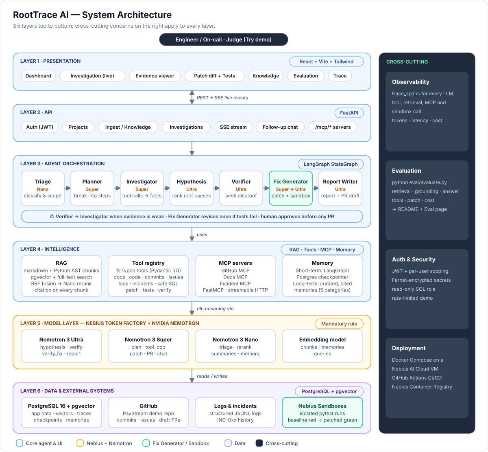
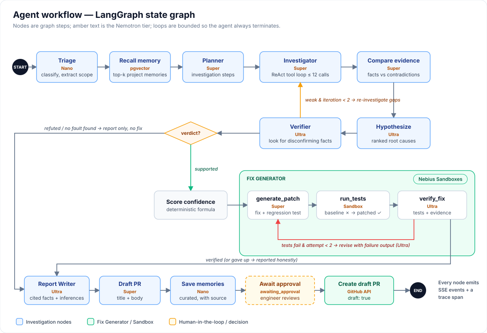
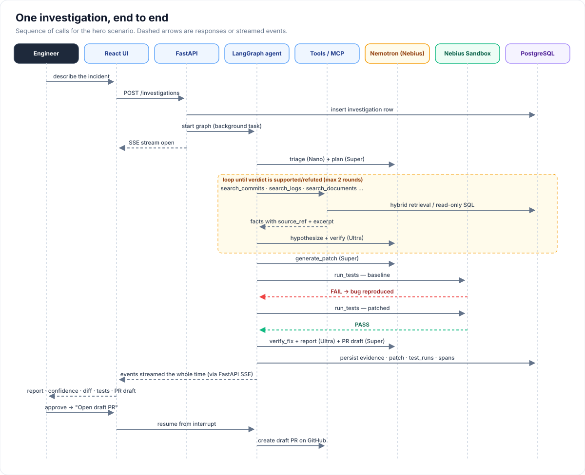
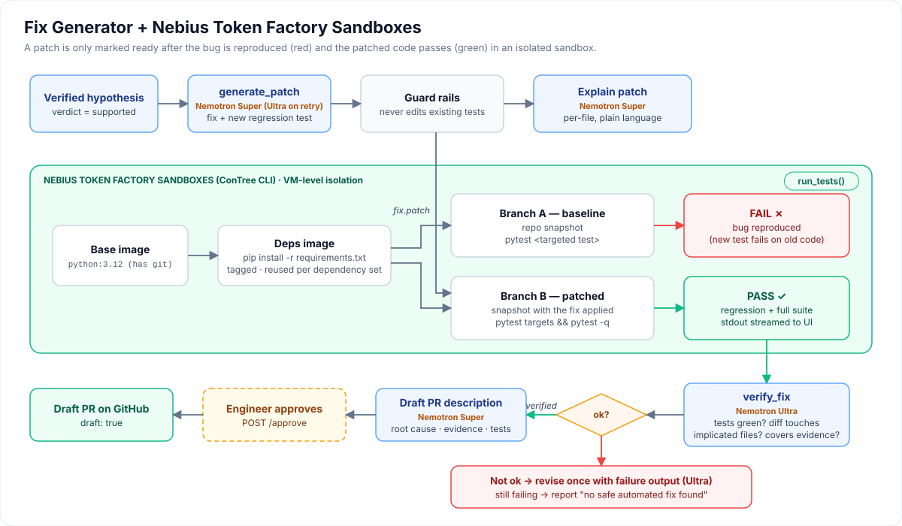
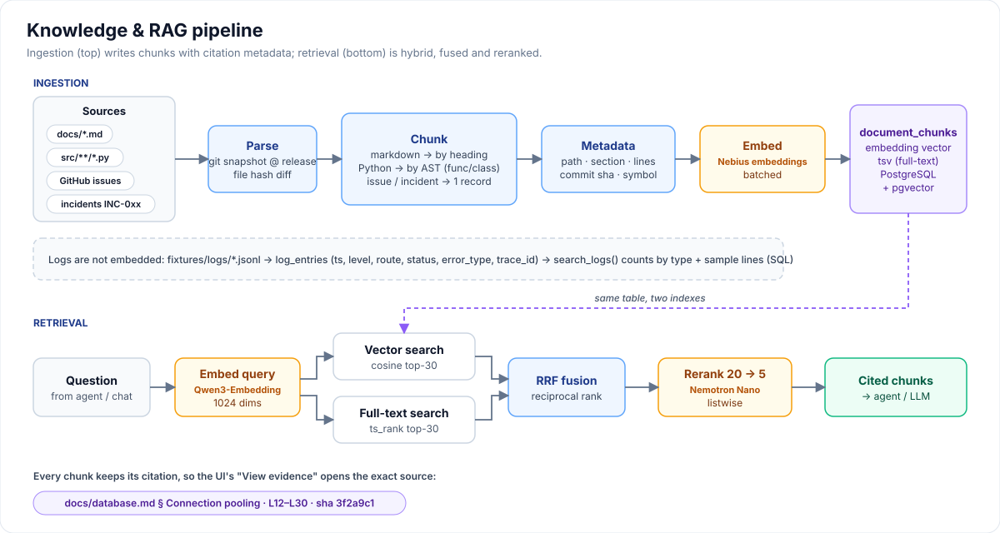
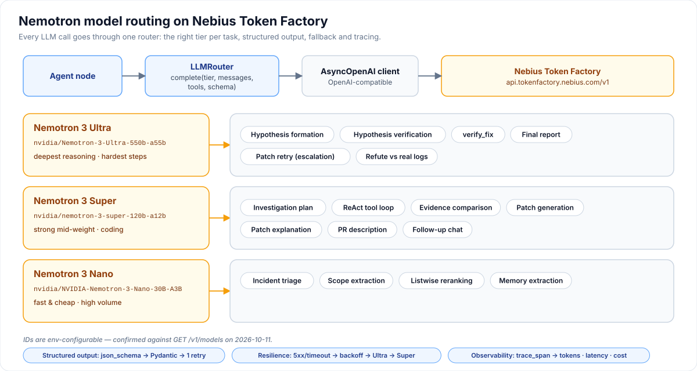
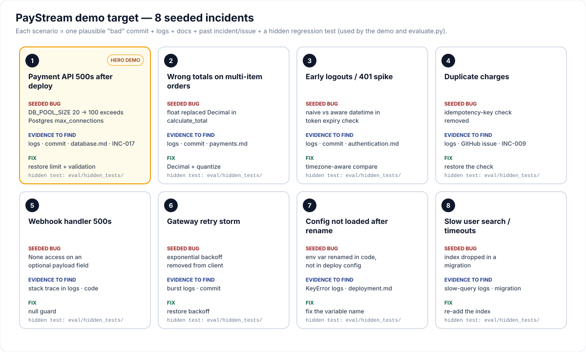
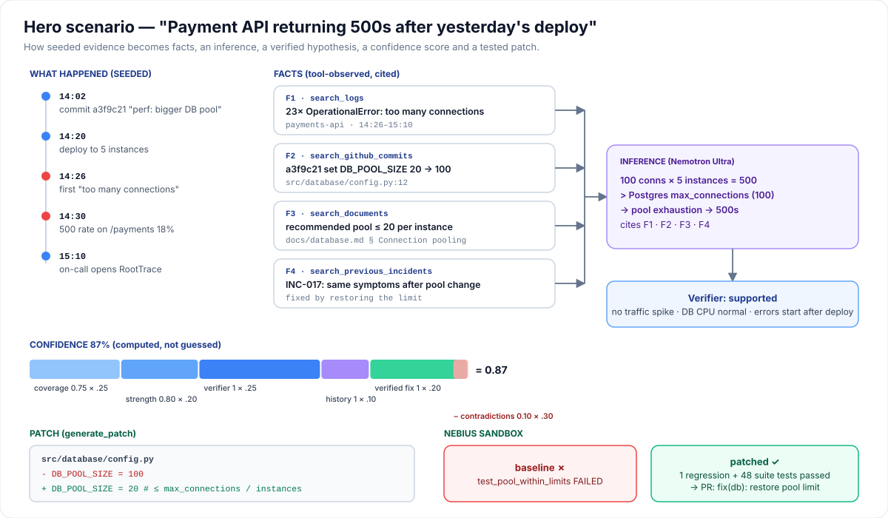
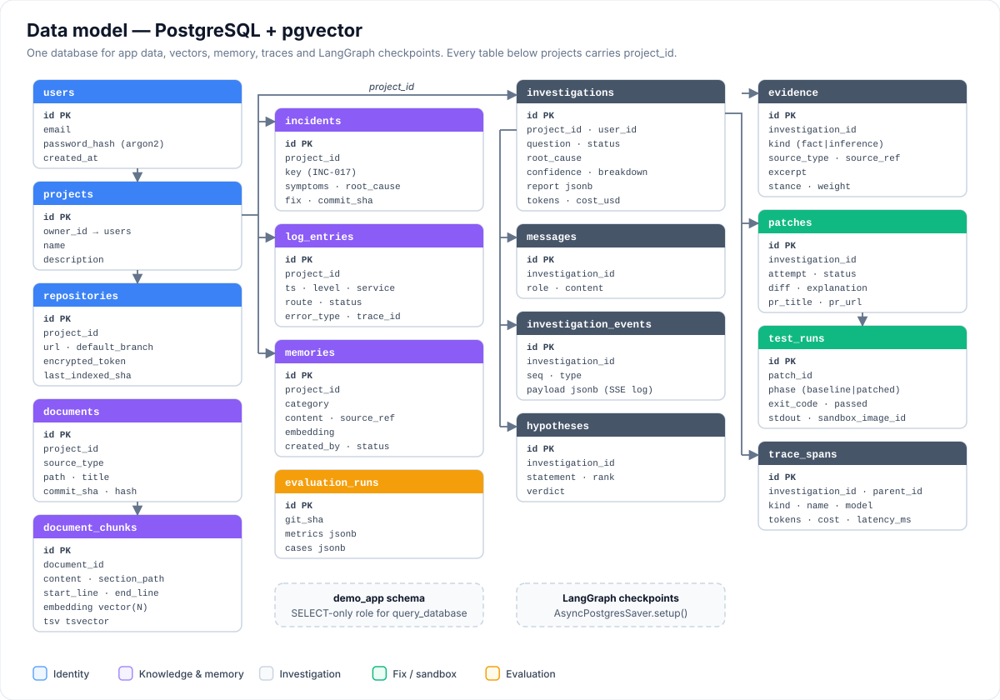
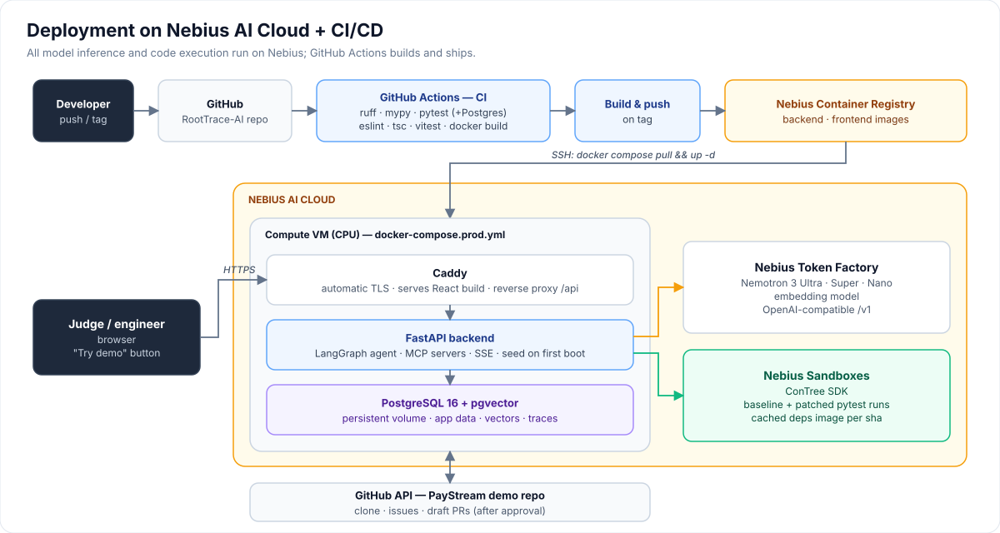

# RootTrace AI — AI Engineering Incident Investigator

> An agent that investigates production incidents across code, commits, docs, logs, GitHub issues and past incidents. It produces an evidence-backed root cause with a confidence score, then **writes, tests and verifies a fix** in a Nebius Sandbox and drafts the pull request.

**Built for the Nebius × NVIDIA Global AI Hackathon** · Primary track: *Coding & Agentic Engineering* · Secondary: *Best Apps & Agents*

- All LLM calls run on **Nebius Token Factory** using **NVIDIA Nemotron 3** models (Ultra / Super / Nano).
- Patches are tested in **Nebius Token Factory Sandboxes**.

> Status: planning complete, implementation starting. Full plan: [docs/IMPLEMENTATION_PLAN.md](docs/IMPLEMENTATION_PLAN.md) · Original concept: [docs/ai-incident-investigator-hackathon-plan.pdf](docs/ai-incident-investigator-hackathon-plan.pdf)

---

## The problem

*"The payment API started returning 500 errors after yesterday's deployment. Find out why."*

To answer that, an on-call engineer has to search docs, read commits, inspect code, dig through logs, check config, compare past incidents, form a hypothesis, verify it, fix it and write it up. Under pressure, that takes hours.

RootTrace does that first investigation in minutes. It shows its reasoning, separates **facts** from **inferences**, and only proposes a fix after reproducing the bug and proving the patch makes the tests pass.

## Contents

1. [System architecture](#1-system-architecture)
2. [Agent workflow](#2-agent-workflow)
3. [One investigation, end to end](#3-one-investigation-end-to-end)
4. [Fix Generator + Nebius Sandboxes](#4-fix-generator--nebius-sandboxes)
5. [Knowledge & RAG](#5-knowledge--rag)
6. [Nemotron model routing](#6-nemotron-model-routing)
7. [Demo scenarios](#7-demo-scenarios)
8. [Hero scenario walkthrough](#8-hero-scenario-walkthrough)
9. [Data model](#9-data-model)
10. [Deployment](#10-deployment)
11. [Tech stack](#tech-stack) · [Repository layout](#repository-layout) · [Evaluation](#evaluation) · [Using it on your own repo](#using-it-on-your-own-repo) · [Limitations & roadmap](#limitations--roadmap) · [Hackathon checklist](#hackathon-checklist)

---

## 1. System architecture



There are six layers. Requests go from the React UI to FastAPI to the LangGraph agent. The agent draws on RAG, the tool registry, the MCP servers and memory. **All reasoning goes through Nemotron on Nebius Token Factory**, and all code execution happens in **Nebius Sandboxes**. Observability, evaluation, auth and deployment apply across every layer.

## 2. Agent workflow



The workflow is a LangGraph state graph with two bounded loops:
- **Verifier → Investigator** when the evidence is weak (at most 2 rounds).
- **Fix Generator** revises its patch once if the tests fail.

The Fix Generator runs only when the hypothesis is *supported*. Before any PR is opened, the graph pauses (`interrupt()`) for the engineer's approval.

## 3. One investigation, end to end



Every step is streamed to the UI over SSE and persisted to `investigation_events`, so a page reload replays the whole investigation.

## 4. Fix Generator + Nebius Sandboxes



This stage is what makes RootTrace a **coding agent** rather than a Q&A tool:
1. Dependencies are installed once into a cached sandbox image, using ConTree branching with `disposable=False`.
2. The baseline run must **fail** (bug reproduced).
3. The patched run must **pass**.
4. Nemotron Ultra checks that the patch actually addresses the evidence.

## 5. Knowledge & RAG



Chunks are split by structure: markdown by heading, Python by AST. Retrieval is hybrid (pgvector plus Postgres full-text), fused with Reciprocal Rank Fusion and reranked by Nemotron Nano. Every chunk carries its citation (file, section, lines, commit). Logs are queried structurally, not embedded.

## 6. Nemotron model routing



| Tier | Used for | Why |
|---|---|---|
| **Nemotron 3 Ultra** | hypothesis, verification, `verify_fix`, final report | deepest reasoning: the investigation's final judgment |
| **Nemotron 3 Super** | planning, tool loop, evidence comparison, patch, PR draft, follow-ups | strong mid-weight reasoning and coding at lower cost |
| **Nemotron 3 Nano** | triage, query rewrite, log summaries, reranking, memory extraction | fast and cheap for high-volume small tasks |

If Ultra is rate-limited, the router falls back to Super, and the downgrade is recorded in the trace.

## 7. Demo scenarios



**PayStream** is a small, purpose-built payments service with eight seeded incidents. Each one has a realistic "bad" commit, matching logs, docs, a related past incident or issue, and a **hidden regression test** the agent never sees. The same scenarios drive the live demo and `evaluate.py`.

PayStream is only test data: the agent, tools and prompts contain nothing PayStream-specific, and CI enforces that. To show it generalizes, a second demo project uses a **real open-source Python repo** with a real past bug, and its evaluation results are reported separately.

## 8. Hero scenario walkthrough



The confidence score is **computed, not guessed**. It is a deterministic formula over source coverage, evidence strength, the verifier's verdict, matching past incidents and whether the fix was verified, minus a penalty for contradictions. The UI shows the breakdown.

## 9. Data model



One PostgreSQL database with pgvector holds application data, embeddings, long-term memory, traces and LangGraph checkpoints. All data is scoped per user and project.

## 10. Deployment



---

## Tech stack

| Layer | Choice |
|---|---|
| Models | NVIDIA Nemotron 3 Ultra / Super / Nano + embedding model on **Nebius Token Factory** (OpenAI-compatible API) |
| Code execution | **Nebius Token Factory Sandboxes** (ConTree SDK) |
| Agent | LangGraph (`StateGraph`, `AsyncPostgresSaver`, `interrupt()`) |
| Backend | Python 3.12, FastAPI, SQLAlchemy 2 + Alembic, Pydantic v2, `uv` |
| Data | PostgreSQL 16 + pgvector |
| MCP | FastMCP servers (GitHub, Docs, Incident), consumed via `langchain-mcp-adapters` |
| Frontend | React + Vite + TypeScript, Tailwind + shadcn/ui, TanStack Query, Monaco diff, Recharts |
| Infra | Docker Compose on Nebius AI Cloud, Nebius Container Registry, GitHub Actions |

## Repository layout

```
backend/            FastAPI app: llm/, rag/, tools/, agent/, sandbox/, memory/, mcp_servers/, observability/
frontend/           React app: Dashboard, Investigation, Knowledge, Evaluation
demo-target/        PayStream service + scripts that build its seeded git history
eval/               cases.yaml, hidden_tests/, evaluate.py, results/
infra/              docker-compose files, Caddyfile, sandbox image
docs/               concept PDF, implementation plan, diagrams/
```

## Evaluation

`python eval/evaluate.py` runs the real pipeline over the PayStream cases and reports:
- retrieval recall
- evidence grounding
- answer accuracy
- tool selection
- patch correctness (hidden tests in a Nebius Sandbox)
- suite pass rate
- negative-case precision
- latency and cost

Results are generated by the script and inserted below, never written by hand.

<!-- EVAL_RESULTS_START -->
*No evaluation run yet.*
<!-- EVAL_RESULTS_END -->

## Using it on your own repo

RootTrace is not tied to the demo repo. Connect any GitHub repository and:

1. **Code, docs, commits and issues** are indexed automatically.
2. **Logs and incident history** can be uploaded as JSONL/CSV (logs) or YAML/JSON/CSV (incidents).
3. **Sandbox testing** uses the repo's own `setup_command` and `test_command`. They are auto-detected for Python projects and can be edited per repository.
4. **Investigation-only mode:** if the repo's tests can't run in the sandbox (for example, they need a live database), you still get a cited root cause and a proposed patch, clearly marked **untested**.

## Limitations & roadmap

| Today (hackathon scope) | Roadmap |
|---|---|
| Best on **Python** repos (AST chunking, pytest) | Multi-language chunking with tree-sitter; detect npm/go/cargo/maven test commands |
| Logs and incidents come from **uploaded files** | Live integrations: Sentry, Datadog, Grafana Loki, PagerDuty, OpenTelemetry |
| GitHub access via a personal access token | GitHub App with fine-grained, per-repo permissions |
| Investigations run as in-process background tasks on one VM | Job queue and workers for multi-user scale |
| Sandbox tests only for repos that install cleanly and need no external services | Service containers (Postgres, Redis) inside the sandbox |
| Self-hosted, bring your own Nebius API key | Hosted version after a security and privacy review |

Patch quality on unfamiliar codebases will be lower than on the seeded demo, which is why every patch needs engineer approval before a PR is opened.

## Hackathon checklist

- [ ] Working demo URL (with a "Try demo" button)
- [ ] Demo video ≤ 3 minutes: full investigation → patch → red/green tests → PR draft
- [ ] Public repo with an Apache-2.0 license
- [ ] README covering Nemotron tiers, Token Factory + Sandboxes, architecture, setup and evaluation
- [ ] Feedback note on Nebius and NVIDIA tools (`docs/FEEDBACK.md`)
- [ ] Evaluation results from `evaluate.py` in this README

## License

Apache-2.0 (to be added as `LICENSE`).
